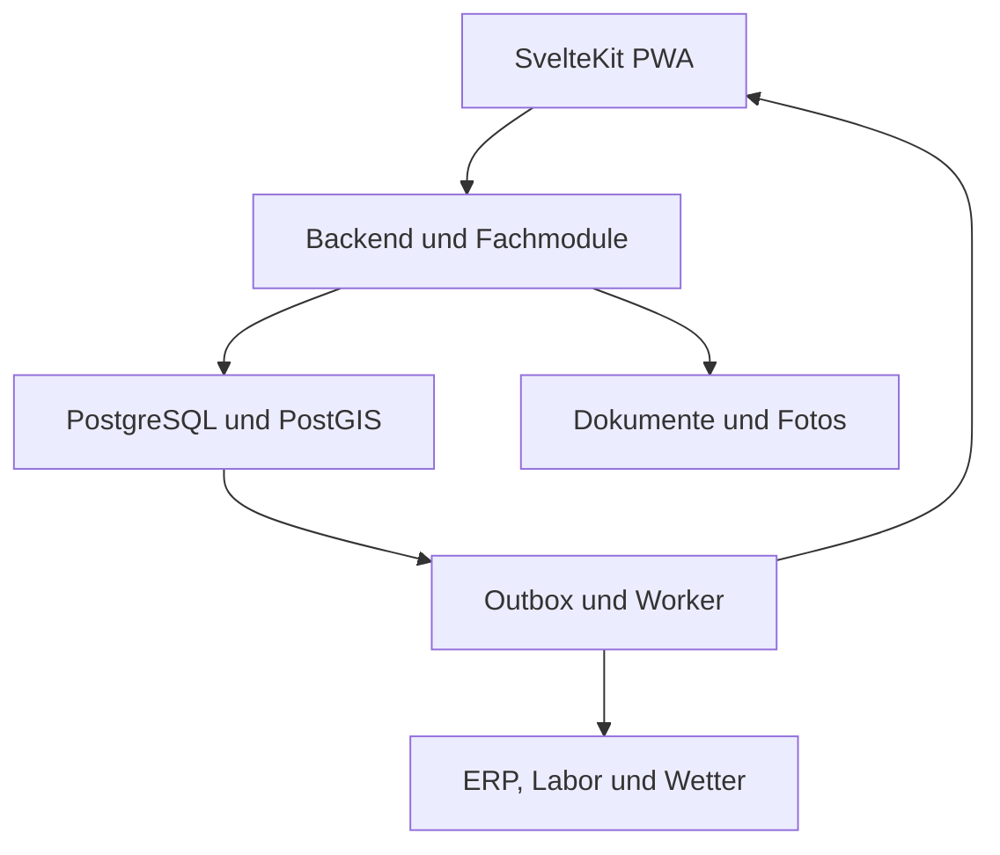
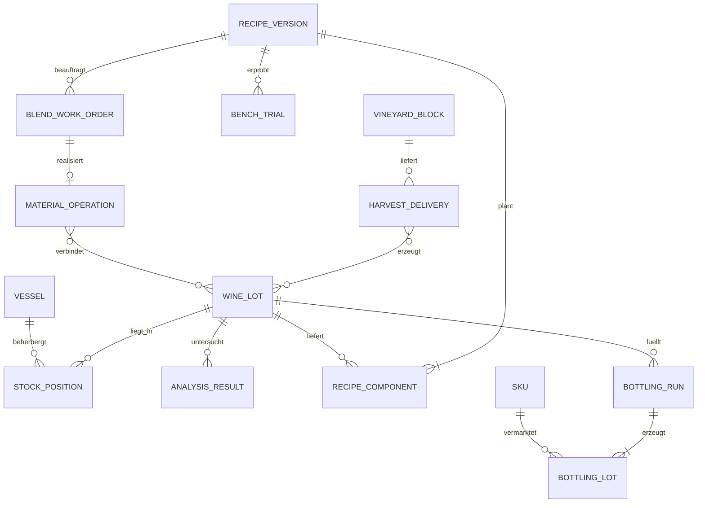

# Winzer-App: Produktplan, Architektur, Domain Model und KI-Umsetzungsprompt

Stand: 10. Oktober 2026 · Sprache: Deutsch · Arbeitstitel: **Vinea** (Name nicht auf Markenverfügbarkeit geprüft)

## 1. Ziel und Annahmen

Eine gemeinsame App für die operative Arbeit im Weinberg und Keller: Aufgaben erfassen, Lese koordinieren, Partien und Gefäße verfolgen, Laborwerte verstehen, Cuvées entwickeln, Produktion dokumentieren und Daten mit vorhandenen Geschäftssystemen austauschen. Der rote Faden ist die Herkunftskette **Parzelle → Ernte → Most/Weinpartie → Verarbeitung/Cuvée → Abfüllcharge → ERP-Artikel**.

Die App soll vor allem das tägliche Arbeiten vereinfachen. Ein Betrieb kann einzelne Module nutzen, ohne Stammdaten mehrfach anzulegen. Ein bestehendes ERP bleibt zunächst für Aufträge, Rechnungen und kaufmännische Bestände verantwortlich. Die App übernimmt operative Produktion und Planung. Auch ein Betrieb ohne ERP kann sie nutzen; vollständige Finanzbuchhaltung, Kasse und Webshop werden nicht im ersten Release gebaut.

**Kontextgrenze:** Die Anfrage der vorherigen Unterhaltung ist vorhanden, die damalige vollständige Antwort mit den einzelnen Ideen jedoch nicht. Die folgende Liste ist deshalb eine eigenständig konsolidierte Gesamtausarbeitung für die genannten Bereiche, keine nachweislich identische Übernahme aller früheren Vorschläge. „Küvettierung“ wird als Cuvéetierung/Assemblage verstanden.

**Planungsannahmen:** Zunächst kleine bis mittelgroße, eigenständige Weingüter im deutschsprachigen Raum; Startpilot in einer konkret zu wählenden deutschen Weinregion; Desktop für Planung, Smartphone für Ausführung; SaaS mit mehreren getrennten Betrieben. Diese Segmentierung und die Pains sind Hypothesen, die mit Pilotbetrieben überprüft werden müssen. Genossenschaften und Lohnverarbeitung können später zusätzliche Eigentums- und Abrechnungsmodelle benötigen.

Technische Empfehlung für dieses Projekt: SvelteKit/TypeScript im Frontend und zunächst auch für den Backend-Monolithen, PostgreSQL als Datenbank. Rust ist eine spätere Option für einen nachweislich rechenintensiven Optimierer oder Geräteadapter, keine notwendige Voraussetzung für den Start.

## 2. Produktidee und Schwerpunkt

**Versprechen:** „Einmal erfassen. Vom Weinberg bis zur Flasche nachvollziehen. Gute Entscheidungen im Keller treffen.“

Die Produktchance liegt nicht allein in einer langen Funktionsliste. Sie liegt in schneller mobiler Erfassung, belastbaren Mengen, nachvollziehbaren Cuvée-Versuchen und einem verständlichen Datenaustausch. Cuvée-Entwicklung eignet sich als möglicher Einstieg: Ein Betrieb kann vorhandene Partien importieren, Versuche dokumentieren und Nutzen erhalten, bevor der gesamte Betrieb umgestellt ist.

### 2.1 Vollständiger Modulkatalog

| Modul | Vermuteter Pain | Funktionen | Ergebnis im Alltag | Ausbau |
|---|---|---|---|---|
| Heute & Aufgaben | Zettel, Zurufe, vergessene Übergaben | Aufgaben nach Ort/Partie, Zuständigkeit, Termine, Checklisten, Fotos, Status, Übergabe | Team sieht die nächsten konkreten Arbeiten | MVP |
| Weinberg & Schlagkartei | Informationen verteilen sich auf Personen und Dateien | Parzellen, Sorten, Pflanzjahr, Saison, Arbeitsgänge, Beobachtungen, Material- und Zeitaufwand | Verlauf pro Parzelle an einem Ort | Basis MVP, Details Phase 2 |
| Wetter & Arbeitsfenster | Unsichere Planung und fehlender lokaler Kontext | Wetterimport, lokale Stationen, Herkunft/Zeit der Prognose, konfigurierbare Hinweise | Arbeitsfenster erkennen; keine automatische Ausführung | Phase 2 |
| Pflanzenschutz & Bewässerung | Nachweise und Fristen sind aufwendig | Erfassung von Produkt, Menge, Fläche, Anwender, Zeitpunkt, Quelle und Freigabe; Wasserverbrauch | Bessere Dokumentation und prüfbare Daten | Phase 2 mit Fachprüfung |
| Reife & Lese | Proben, Teams, Behälter und Kellerkapazität sind schlecht abgestimmt | Reifeproben, Leseplanung, Team-/Maschineneinsatz, Wiegeeingang, Lieferanten, Qualitätsbefund | Ernte kommt mit nachvollziehbarer Herkunft im Keller an | Basis MVP, Planung Phase 2 |
| Keller & Partien | Tankinhalt und letzte Bearbeitung sind unklar | Tank-/Fassübersicht, QR, Umziehen, Teilen, Mischen, Zugaben, Verluste, Sperren, Historie | Verlässlicher Zustand pro Gefäß und Partie | MVP |
| Gärung & Labor | Messwerte liegen verstreut; Auffälligkeiten fallen spät auf | Proben, Messreihen, Referenzbereiche, Verlauf, manuelle Warnregeln, Laborimport | Abweichungen mit Zeit und Datenqualität erkennen | Basis MVP, Sensorik Phase 2 |
| Cuvée-Studio | Versuche sind nicht reproduzierbar; Mengenplanung erfolgt getrennt | Rezeptversionen, Bench Trials, Blindverkostung, Vergleich, analytische Schätzung, Verfügbarkeit, Freigabe | Vom Versuch zum ausführbaren Kellerauftrag | MVP-Schwerpunkt |
| Abfüllung & Material | Wein-, Verpackungs- und Dienstleisterplanung passen nicht zusammen | Abfüllauftrag, Materialbedarf, tatsächliche Ausbeute, Chargen, Rückstellmuster, ERP-Übergabe | Flüssigbestand wird nachvollziehbar zu Flaschenbestand | Basis MVP, Planung Phase 2 |
| Hygiene & Wartung | Reinigung und Defekte werden nicht zuverlässig übergeben | Reinigungsstatus, Checklisten, Wartung, Betriebsmittel, Meldungen | Geeignete Gefäße und Geräte finden | Phase 2 |
| Kosten & Auswertung | Kosten pro Wein sind nur grob bekannt | Arbeit, Material, Dienstleister, Verluste, Kosten pro Liter/Flasche; geplante vs. tatsächliche Werte | Wirtschaftliche Entscheidungen unterstützen | Basis Phase 2 |
| Nachweise & Herkunft | Zusammenstellen der Historie kostet Zeit | Partienbaum, Arbeitsnachweise, versionierte PDF-/CSV-Berichte, Regelprüfungen | Nachweise schneller zusammenstellen | Herkunft MVP; Regelpakete Phase 2 |
| Datenhub | Doppelerfassung zwischen Excel, Labor und ERP | Importassistent, Mapping, API, Exportprofile, Sync-Protokoll, Fehlerkorrektur | Ein nachvollziehbarer Austauschprozess | MVP |
| KI-Assistent | Informationen und Dokumentation sind zeitaufwendig | Sprach-/Textnotiz als Entwurf, OCR-Vorschlag, Suche in freigegebenen Daten, erklärende Zusammenfassungen | Weniger Tippen und schnelleres Auffinden | Phase 3; Kern auch ohne KI |

### 2.2 Validierung vor größerem Ausbau

Mit 5–8 Betrieben reale Arbeitsabläufe beobachten: eine Tankbewegung, eine Laborprobe, einen Cuvée-Versuch, einen ERP-/Excel-Abgleich und einen Lesetag. Erfassen: Dauer, Fehler, vorhandene Systeme, Netzabdeckung, fachliche Freigaben und Zahlungsbereitschaft. Keine Nachfrage aus bloßer Zustimmung ableiten: prüfen, ob Betriebe echte Daten bereitstellen und einen Pilot aktiv nutzen.

Erfolgsmessung: Zeit je Erfassung, Anteil fehlgeschlagener/ungeklärter Synchronisierungen, Anzahl unklarer Bestände, Reproduzierbarkeit eines Versuchs, aktive Nutzung pro Rolle und Zeitaufwand für den Wochenabgleich. Ausgangswerte im Pilot erheben, Ziele danach setzen.

## 3. Cuvée-Studio: ausführliches Konzept

### 3.1 Durchgängiger Arbeitsablauf

1. **Briefing anlegen:** Zielmenge, Stil, geplante Kosten, gewünschte Parameter, verfügbare Partien und betriebliche Anforderungen.
2. **Quellweine auswählen:** Bestand, Reservierung, Herkunft, Rebsorte, Jahrgang, Laborwerte, Sperrstatus und Datenalter werden angezeigt.
3. **Varianten entwickeln:** Prozent- oder Literangaben, fixierte Komponenten, Minimal-/Maximalanteile, Vergleich zum Referenzwein.
4. **Bench Trial vorbereiten:** z. B. 100/250/500 ml, Entnahmeliste, Probenetiketten, Anleitung und dokumentierte Rundung.
5. **Versuch verkosten:** offene oder blinde Sitzung, individuelle Bewertungen, Kommentar, Wiederholungsprobe und Rangfolge.
6. **Variante überarbeiten:** neue unveränderliche Rezeptversion; Bewertungen bleiben beim tatsächlich verkosteten Versuch.
7. **Fachlich freigeben:** Labor-/Herkunftsprüfung, aktueller Bestand und geeigneter Zieltank; Rezeptversion und Datensnapshot festhalten.
8. **Produktionsauftrag ausführen:** geplante Mengen und tatsächliche Entnahmen separat erfassen; Freigabe bei relevanten Abweichungen erneuern.
9. **Nachkontrolle:** reale Analyse, Sensorik, Abweichung zur Schätzung, Kosten und spätere Abfüllung verbinden.

### 3.2 Zusätzliche App-Ideen im Cuvée-Studio

| Idee | Konkrete Umsetzung | Nutzen | Grenze |
|---|---|---|---|
| Reproduzierbare Versuchskarte | Rezept, Quelle, Entnahmedatum, Probengröße, Probenvorbereitung und Version | Ein guter Versuch geht nicht verloren | Probenalter beeinflusst Vergleichbarkeit |
| Blindverkostungsmodus | Zufallscodes, getrennte Codeauflösung, zufällige Reihenfolge je Verkoster | Weniger Erwartungseinfluss | Kleine Panels liefern keine sicheren statistischen Aussagen |
| Variantenvergleich | Mengen/Kosten/Analyseschätzung nebeneinander; gemeinsame sensorische Skalen | Entscheidung wird nachvollziehbar | Sensorik nicht als exakte Mischformel behandeln |
| Constraint-Assistent | Mengen, Kosten, Verfügbarkeit, Anteilgrenzen, Herkunftsanforderungen | Unmögliche Rezepte früh erkennen | Regionale Regeln nur mit geprüften Regelpaketen |
| Restmengenplanung | Nach einer Cuvée verbleibende Mengen für weitere Rezepte sichtbar machen | Vermeidet ungewollte kleine Restbestände | Restweine dürfen keine Qualitätsprobleme verdecken |
| Mehrere Cuvées gleichzeitig | Gemeinsame Ressourcen über mehrere Pläne reservieren und optimieren | Keine doppelte Verplanung derselben Partie | Erst nach funktionierender Einzelplanung |
| Jahrgangskonsistenz | Freigegebene sensorische Zielprofile früherer Produkte vergleichen | Stil über Jahre besser diskutieren | Jahrgänge und Verkostungen sind nicht beliebig vergleichbar |
| Referenz- und Rückstellproben | Physische Probe, Lagerort und Verkostungstermine verknüpfen | Verbindung zwischen Rezept und realem Produkt | Probe ist nicht gleich digitaler Datensatz |
| Scale-up-Prüfung | Versuchsmengen auf Produktionsmenge skalieren; Quellen, Pumpenweg, Tankkapazität prüfen | Weniger Übertragungsfehler | Keine automatische Anlagensteuerung |
| Produktionsreihenfolge | Reinigungsstatus und freie Gefäße zur Planung nutzen | Weniger Umplanung im Keller | Ablauf ist ein freizugebender Vorschlag |
| Pareto-Vorschläge | Mehrere feasible Varianten nach Kosten, Zielabweichung, Restmengen vergleichen | Transparente Optionen statt einer angeblich perfekten Cuvée | Geschmack lässt sich nicht zuverlässig aus Laborwerten vorhersagen |
| Lernarchiv | Frühere Rezeptversionen, Verkostungen, spätere Analysen und Produktfeedback | Erfahrungswissen bleibt im Betrieb | Kein trainiertes Vorhersagemodell ohne genügend passende Daten |

### 3.3 Rechenmodell und fachliche Grenzen

Rezeptmengen werden mit dezimaler Präzision gespeichert. Für Quelle i: Volumen v_i, Zielvolumen V = Summe(v_i), Anteil w_i = v_i / V. Ein Rezept ist erst gültig, wenn V > 0 und alle Mengen nicht negativ sind. Prozentangaben müssen mit definierter Rundung 100 % ergeben.

Für einen ausreichend konservativen, vergleichbar gemessenen Konzentrationsparameter kann als **Planungsschätzung** gelten: c_mix = Summe(v_i × c_i) / V. Voraussetzung: gleiche Einheit, vergleichbare Methode/Basis und geeignete Annahmen zu Volumen und Reaktionen. Volumenadditivität ist eine Planungsannahme; reale Abweichungen werden gemessen und dokumentiert. Alkohol (% vol), Restzucker und vergleichbare Konzentrationen können so näherungsweise geplant werden. Gesamtsäure nur mit gleicher Bezugsbasis/Methode und expliziter Kennzeichnung als Näherung; Reaktionen und Ausfällungen können Werte verändern.

**pH nicht linear mitteln.** Auch das Mitteln der Wasserstoffionenkonzentration bildet gepufferte Weine nicht ausreichend ab. Ohne validiertes chemisches Modell wird kein Misch-pH berechnet; stattdessen „Analyse des realen Versuchs erforderlich“. Freies SO₂, mikrobiologische Stabilität, Aroma, Farbe, Tanninwahrnehmung und Haltbarkeit sind keine verlässlich linear mischbaren Produkteigenschaften. Für solche Felder höchstens Eingangsvergleich, keine scheinpräzisen Ergebniswerte.

Jeder Ergebniswert trägt `estimated` oder `measured`, Modellversion, Eingabereferenzen, Messdatum und fehlende/alte Daten. Fehlende Werte niemals als 0 behandeln. Bei inkompatiblen Methoden keine Berechnung. Fehlende Daten können die Schätzung verhindern; sie müssen nicht pauschal das Anlegen eines Versuchs verhindern.

**Beispiel:** Variante mit 60 % A und 40 % B, Ziel 1.000 L; A 12,0 % vol und 2 €/L, B 13,5 % vol und 3 €/L. Planung: A 600 L, B 400 L, Alkohol ca. 12,6 % vol; reine Weinkosten 2.400 €, entsprechend 2,40 €/L. Ein 250-ml-Versuch benötigt 150 ml A und 100 ml B. Arbeit, Verluste und Verpackung fehlen noch. Bei pH A 3,2 / B 3,8 darf die App nicht 3,44 als erwarteten Misch-pH ausgeben.

### 3.4 Optimierung

Start mit manueller Rezeptplanung und deterministischer Validierung. Später LP/MILP für linearisierbare Constraints: v_i >= 0; Summe(v_i) = Zielmenge; v_i <= verfügbarer Bestand; Anteilgrenzen; Kostenbudget; kompatible analytische Zielbereiche. Ganzzahlige Containerwahl kann MILP erfordern. Eine nachvollziehbare Zielfunktion kombiniert Kosten, analytische Zielabweichung und Restmengen mit offengelegten Gewichten. Keine sensorische Qualitätsgarantie.

Wenn keine Lösung existiert: verletzte Bedingungen nennen; keine Grenzen still lockern. Löserausgaben vor Anzeige unabhängig validieren. Reservierungen entstehen erst bei bewusster Planung/Freigabe, nicht beim Verschieben jedes Sliders. Ein freigegebenes Rezept garantiert keinen später noch vorhandenen Bestand; Ausführung prüft ihn erneut.

Die OIV beschreibt Cuvée-Entwicklung unter anderem für gewünschte analytische, sensorische und preisliche Eigenschaften und schließt das Verdecken mikrobiologischer oder chemischer Veränderungen aus [S3]. Daraus folgt im Produkt: gesperrte/auffällige Partien dürfen nicht durch eine Optimierung „weggebunden“ werden. OIV-Empfehlungen ersetzen kein regional anwendbares Recht.

## 4. Nutzererlebnis

### Rollen

| Rolle | Schwerpunkt | Berechtigungsbeispiel |
|---|---|---|
| Betriebsleitung | Planung, Kosten, Freigaben | Module, Benutzer und Datenquellen konfigurieren |
| Kellermeister/Önologe | Partien, Analysen, Cuvées | Rezept und Produktionsauftrag freigeben |
| Kellerteam | Ausführen und dokumentieren | Gefäß scannen, Werte/Bewegungen erfassen |
| Weinbergteam | Arbeiten und Beobachtungen | Zugewiesene Flächen und Aufgaben erfassen |
| Labor/Externe Beratung | Analytik und Befunde | Explizit freigegebene Proben lesen/ergänzen |
| Büro | Datenabgleich und Exporte | Importfehler lösen, ERP-Mapping bearbeiten |

Berechtigungen sind Aktionen plus Umfang, nicht bloß sichtbare Menüpunkte. Externe Nutzer nur mit explizitem Zugriff auf ausgewählte Betriebsdaten; Mandantentrennung bleibt erhalten.

### Navigation

**Heute · Weinberg · Lese · Keller · Cuvées · Labor · Abfüllung · Auswertungen · Datenhub**. Verwaltung in einem separaten Bereich. Module können ausgeblendet werden; fachliche Daten bleiben integriert.

Mobile Startseite: „Scannen“, „Beobachtung“, „Messwert“, „Aufgabe erledigen“. Kellerdetail: Identität, tatsächlicher Inhalt, Menge, letzte Analyse, Sperren und nächste Aufgabe. Cuvée-Desktop: Quellen links, Rezept/Varianten mittig, Schätzungen und Validierung rechts; auf Mobil sequenzieller Ablauf. Jede Warnung nennt Grund und nächste Handlung. Filterbare Tabellen ergänzen visuelle Tank-/Parzellenansichten.

QR enthält eine opake Objekt-ID oder authentifizierungspflichtige URL, keine vertraulichen Daten. Physisches Etikett benennt Gefäß/Probe. Kameraausfall braucht Suche/Codeeingabe. Große Touchziele, starke Kontraste, vollständige Tastaturbedienung und Status nie nur über Farbe; WCAG 2.2 AA als Abnahmeanforderung. Spracheingabe optional, normale Formulare vollständig nutzbar.

## 5. Systemarchitektur

### 5.1 Empfehlung: modularer Monolith mit asynchronen Jobs

Ein System mit klar getrennten Fachmodulen und einer relationalen Transaktionsgrenze. Keine Microservice-Landschaft im MVP, kein vollständiges Event Sourcing. Mengenjournal und Audithistorie sind append-only; Stammdaten und Projektionen werden normal relational gespeichert. Domain Events entkoppeln Folgearbeit über eine Transactional Outbox.



| Baustein | Entscheidung | Begründung |
|---|---|---|
| Frontend | SvelteKit, TypeScript, responsive PWA | Eine Oberfläche für Büro und mobile Erfassung |
| Backend | SvelteKit Server-Routen; Fachlogik in frameworkfreien Modulen | Gleiche Sprache, geringe Startkomplexität |
| Verträge | OpenAPI 3.1, JSON Schema und Laufzeitvalidierung | Stabile Integrations- und Sync-Schnittstelle |
| Daten | PostgreSQL, PostGIS für Parzellen; versionierte SQL-Migrationen | Mengenbuchungen brauchen Transaktionen; Geodaten bleiben querybar |
| Dezimalwerte | PostgreSQL NUMERIC, Decimal-Library im Server; JSON als Strings | Keine binären Floatfehler bei Mengen und Geld |
| Offline | IndexedDB mit Outbox; Service Worker für App-Shell | Entwürfe/Erfassungen ohne Empfang ermöglichen |
| Auth | Etablierter OIDC-Anbieter mit EU-Hostingoption, serverseitige Session | Keine selbst entwickelte Passwortverwaltung |
| Dokumente | EU-Objektablage mit privaten, kurzlebigen URLs | PDFs, Fotos und Originalimporte getrennt von relationalen Daten |
| Worker | Separater Prozess, dauerhafte Jobs in PostgreSQL | Imports, Berichte und Adapter unabhängig vom Request |
| Echtzeit | Im MVP Polling auf Änderungen; später SSE | Offline und Korrektheit sind wichtiger als WebSockets |
| Betrieb | EU-Deployment, Managed PostgreSQL mit PITR, Worker-Host | Wiederherstellbarkeit und einfache Wartung |
| KI | Später serverseitiger Provideradapter | Kernoperationen bleiben deterministisch |

Vercel ist eine Option für Web/Request-Routen, sofern gewählte Daten- und Regionenanforderungen passen. Ein dauerhafter Worker wird separat gehostet; keine unendlichen Hintergrundschleifen in Request-Funktionen. Alternativ alle Prozesse auf einer EU-Plattform für Container betreiben. GitHub für Code/CI, nicht als produktive Bestandsdatenbank.

### 5.2 Modulgrenzen

`identity`, `vineyard`, `harvest`, `cellar`, `laboratory`, `blending`, `bottling`, `work`, `costing`, `compliance`, `integration`, `documents`, `insights`.

Jedes Modul besitzt Tabellen, Commands, Queries und fachliche Regeln. Andere Module ändern diese Tabellen nicht direkt. Gemeinsame Transaktionen koordinieren kritische Buchungen über Application Services. Dashboards nutzen Read Models. Eine Partie-ID verbindet Keller, Labor, Cuvée und Abfüllung; ERP-IDs sind externe Referenzen.

### 5.3 Deployment und Repo

```text
apps/web/                   SvelteKit UI und API
apps/worker/                Jobverarbeitung, Imports, Exporte
packages/domain/            Fachmodule, Commands, Regeln
packages/contracts/         API- und Eventschemas
packages/db/                Migrationen, Repositories, RLS
packages/integrations/      Adapter und Capability-Matrix
packages/ui/                Komponenten und Tokens
packages/testing/           Fachfixtures und Hilfen
docs/                       ADRs, Domain, Betrieb, API
```

Lokaler Start mit Web, Worker, PostgreSQL/PostGIS und optionaler S3-kompatibler Ablage. Staging verwendet anonymisierte/synthetische Daten. Migrationen rückwärtskompatibel ausrollen; nach erfolgreicher Migration neue App deployen. Secrets ausschließlich serverseitig. Keine produktiven Daten oder Tokens im Git-Repository.

## 6. Domain Model

### 6.1 Begriffe, die nicht vermischt werden dürfen

**Partie** = fachlich nachvollziehbare Menge Wein/Most mit Identität und Historie. **Gefäß** = physischer Tank, Fass oder Behälter. **Bestandsposition** = Menge einer Partie an einem Ort. **Rezept** = Plan. **Mischung** = tatsächliche Produktionsoperation. **Produkt** = vermarktete Weinidentität. **Abfüllcharge** = konkrete Herstellung/Los. **SKU** = kommerzieller Artikel, z. B. Flaschengröße/Verpackung, der mit einer oder mehreren Abfüllchargen verbunden sein kann.

Eine Partie kann auf mehrere Gefäße verteilt sein. Beim Zusammenmischen unterschiedlicher Partien entsteht eine neue Partie mit Herkunftskanten. Das Einfüllen in einen bereits gefüllten Tank darf nicht still zwei unabhängige Weine als einen unveränderten Inhalt anzeigen. Physische Mischung muss explizit gebucht werden.

### 6.2 Entitäten und zentrale Felder

Alle mandantenbezogenen Tabellen: `id UUID`, `tenant_id`, `created_at`, `created_by`; veränderliche Aggregate zusätzlich `version`, `updated_at`. Zeiten in UTC, Anzeige in Betriebszeitzone; fachliche Tage separat als Datum. Mengen immer Wert + Einheit + gegebenenfalls Messbasis. Externe IDs nicht als interne Primärschlüssel verwenden.

| Kontext | Entität | Zentrale Felder/Beziehungen |
|---|---|---|
| Identität | Tenant, Site | Betrieb, Standort, Land/Region, Zeitzone |
| Identität | User, Membership, Permission | Benutzer, Betrieb, Rolle und Aktionsumfang |
| Weinberg | VineyardBlock | Standort, Polygon, Fläche, Rebsorten/Pflanzung |
| Weinberg | BlockSeason | Parzelle, Jahr, Bewirtschaftung, geplante Erträge |
| Weinberg | Observation, FieldOperation | Parzelle/Saison, Befund, Tätigkeit, Zeit, Material |
| Weinberg | WeatherObservation, WeatherForecast | Station/Anbieter, Messzeit bzw. Ausgabe- und Gültigkeitszeit |
| Lese | MaturitySample | Saison, Entnahmestelle, Datum, Proben-ID |
| Lese | HarvestPlan, HarvestDelivery | Parzelle/Lieferant, geplant/gewogen, Zeit, Qualität |
| Keller | WineLot | Code, Materialtyp, Status, Entstehungsoperation, Freigaben |
| Keller | Vessel | Standort, Typ, nominale/nutzbare Kapazität, Status |
| Keller | StockPosition | Partie, Gefäß/Ort, projizierte Menge und Version |
| Keller | MaterialOperation | Typ, Status, Zeitpunkt, Eingänge/Ausgänge, Verluste, Belege |
| Keller | LedgerEntry | Operation, Position, vorzeichenbehaftete Menge, Einheit, Gegenkonto |
| Herkunft | LineageEdge | Eingangs-/Ausgangspartie, Operation, Mengenbasis, Beitrag |
| Keller | Reservation | Partie/Position, Menge, Zweck, Ablauf, Zustand |
| Keller | Treatment | Partie/Operation, Mittel/Charge, Menge, Anwender, Freigabe |
| Labor | Sample, AnalysisResult | Probe, Partie, Parameter, Wert, Einheit, Methode, Entnahme-/Analysezeit |
| Labor | FermentationRun | Partie, Start/Ende, Status, Messreihen |
| Cuvée | BlendProject | Briefing, Zielmenge/-profil, Produkt, Constraints |
| Cuvée | RecipeVersion, RecipeComponent | unveränderlicher Snapshot; Quellen, Mengen, Messreferenzen |
| Cuvée | BenchTrial | Rezeptversion, Probenvorbereitung, reale Entnahmen, Probe |
| Cuvée | TastingSession, TastingSample, Evaluation | Blindcode, Teilnehmer, Reihenfolge, Skalen, Bewertung |
| Cuvée | BlendApproval, BlendWorkOrder | Rezeptversion, fachliche Freigabe, Reservierungen, tatsächliche Operation |
| Abfüllung | WineProduct, SKU | Produktidentität, Packungsformat, ERP-Referenz |
| Abfüllung | BottlingRun, BottlingLot | Eingangswein, tatsächliche Flaschen/Liter, Los, Verpackung |
| Bestand | PackagedStockMovement | Abfülllos/SKU/Ort, Zugang/Abgang/Korrektur, ERP-Bezug |
| Arbeit | WorkOrder, Task, ResourceBooking | Objektbezug, Zuständigkeit, Checkliste, Gerät/Team |
| Hygiene | CleaningRecord, MaintenanceRecord | Gerät/Gefäß, Mittel, Zeitpunkt, Durchführung |
| Kosten | CostEntry, CostAllocation | Quelle, Betrag/Währung, direkte/verteile Kosten, Version |
| Regeln | RuleSetVersion, ValidationFinding | Jurisdiktion, Gültigkeit, Quelle, Prüfer, Ergebnis |
| Datenhub | Connection, ExternalReference | Adapter, Fähigkeiten, Geheimnisreferenz, externe ID |
| Datenhub | ImportBatch, ImportRow, MappingProfile | Datei-Hash, Schema, Rohzeile, Mapping, Status |
| Datenhub | SyncJob, SyncConflict, ExportArtifact | Cursor, Wiederholungen, Feldkonflikt, Ausgabesnapshot |
| System | AuditEntry, OutboxEvent, ProcessedMessage | Akteur, Änderung, Event-ID, Zustell-/Dedupstatus |

### 6.3 Kernbeziehungen



Das Diagramm ist fachlich: Many-to-many-Beziehungen werden relational über explizite Eingangs-/Ausgangstabellen und Mengen umgesetzt. Harvest → Most ist eine Transformation, kein behaupteter 1:1-Literbezug aus Kilogramm Trauben.

### 6.4 Aggregate und Zustände

| Aggregat | Zustände | Regel |
|---|---|---|
| MaterialOperation | draft → validated → posted; alternativ cancelled vor Buchung | Gebuchte Operation nur durch referenzierte Gegen-/Korrekturbuchung ändern |
| BlendProject | draft → trial → selected → approved → in_production → completed; cancelled | Zustände nicht mit Bestandsbuchungen gleichsetzen |
| RecipeVersion | draft → frozen → approved; superseded | Nach Freeze neue Version statt Überschreiben |
| WorkOrder | planned → released → in_progress → completed; cancelled | Completion benötigt tatsächliche Mengen/Belege, falls materialrelevant |
| Reservation | active → consumed/released/expired | Teilverbrauch möglich, Rest nachvollziehbar |
| ImportBatch | uploaded → mapped → validated → committed; failed | Commit nur für validierte Zeilen nach expliziter Bestätigung |
| SyncJob | queued → running → succeeded; retrying/failed/ambiguous | Unklare entfernte Schreibausgänge zuerst abgleichen |

## 7. Mengen, Herkunft und Transaktionen

### 7.1 Mengenjournal

Jede tatsächliche Bewegung besitzt Eingänge, Ausgänge und explizite Verluste. Ein Transfer von 500 L aus Tank A nach B bei 3 L Verlust: A −500 L, B +497 L, Verlustkonto +3 L. Journal und Bestandsprojektion werden in **derselben** Datenbanktransaktion geschrieben. Bestände werden nicht frei über ein Formular überschrieben; Inventurdifferenzen sind begründete Korrekturoperationen.

Umwandlungen zwischen kg Trauben, L Most und Flaschen haben eigene Ausbeuten und Einheiten. Keine allgemeine Erhaltungsgleichung „kg = L“. Erhaltung für gleichartige Mengen getrennt prüfen; bei Transformation Eingangsmasse und Ausgangsvolumen nachvollziehbar protokollieren. Bei Abfüllung: Weinverbrauch = nominaler Füllinhalt + separat dokumentierte Abweichung/Verlust/Rest. Flaschenanzahl als Integer, gemessene reale Füllmenge optional separat.

StockPosition speichert eine Projektion; Journal bleibt autoritative Buchungshistorie. Regelmäßiger Abgleich rekonstruiert den erwarteten Bestand. Eröffnungsbestände werden als Eröffnungsoperation mit Quelle und Stichtag erfasst.

### 7.2 Invarianten

- Kein negativer physischer Bestand. Reservierter Bestand nicht größer als freigegebener nutzbarer Bestand.
- Verfügbar = physisch − aktive Reservierungen − quantifizierte Sperrmengen; vollständige Qualitätssperre macht eine Position unverfügbar. Status und Mengen dürfen Sperren nicht doppelt abziehen.
- Geeigneter Zieltank mit ausreichender nutzbarer Kapazität; Belegungsprüfung berücksichtigt reale Vermischung.
- Unterschiedliche Chargen nur über explizite Mischung; dabei neue Partie und Herkunftskanten.
- Jede gebuchte Operation atomar, idempotent und mit Akteur, tatsächlichem Zeitpunkt und Erfassungszeit.
- UUID und tenant_id in zusammengesetzten Fremdschlüsseln: keine Verknüpfung zwischen Betrieben.
- Herkunftsgraph ohne Zyklen; Aufteilungen erhalten Herkunft, Mischung kombiniert sie mengenbasiert.
- Herkunftsanteile aus tatsächlichen Entnahmen ableiten; Rezeptanteile nicht als Produktionsrealität übernehmen.
- Probenentnahmen, wenn bestandsrelevant, ebenfalls buchen; Messwerte allein sind keine Bewegung.
- Bei unbekannter Herkunft keine erfundene Rückverfolgbarkeit. Anteil/Status „unbekannt“ erhalten.
- Manuelle Rückdatierungen und Korrekturen lösen Prüfung abhängiger historischer Berichte aus; bereits ausgestellte Berichte behalten Version und Snapshot.

### 7.3 Parallelität und Idempotenz

Kritische Commands sperren betroffene Positionen/Reservierungen/Gefäße in deterministischer Reihenfolge per `SELECT ... FOR UPDATE`; prüfen aktuelle Mengen und Versionen, schreiben Operation, Journal, Projektionen und Outbox atomar. Serienbezogene Buchungskonflikte bei Bedarf mit serialisierbarer Isolation und begrenztem Retry behandeln. Ein Prozess darf nicht durch mehrere unabhängige HTTP-Aufrufe teilgebucht werden.

Client liefert `Idempotency-Key` und erwartete Aggregate-Version. Eindeutiger Schlüssel pro Betrieb + Command; Payload-Hash speichern. Identischer Wiederholungsaufruf liefert dieselbe Antwort, abweichende Payload unter gleichem Schlüssel wird abgelehnt. Für Command mit eigener Reservierung wird diese bei der Verfügbarkeitsprüfung passend berücksichtigt, damit der Auftrag seinen eigenen Bestand verbrauchen kann.

**Beispiel:** Zwei Benutzer planen jeweils 600 L aus einer 1.000-L-Partie. Planung darf Varianten speichern; zweite tatsächliche Reservierung bzw. Buchung kann nicht ungeprüft erfolgreich sein. Server meldet aktuelle Menge und fordert Anpassung, statt „last write wins“ anzuwenden.

## 8. Offline-Konzept

Offline im MVP: zugewiesene Aufgaben, explizit heruntergeladene Objektkarten, Notizen/Fotos, Messwertentwürfe und Arbeitsnachweise. Offline **keine verbindliche Reservierung, Rezeptfreigabe oder Mengenbuchung**. Ein Kellerbewegungsentwurf kann lokal vorbereitet werden; nach Netzrückkehr validiert der Server und fordert bei veraltetem Bestand eine bewusste Lösung.

Sync-Envelope: `command_id`, `device_id`, `tenant_id`, `entity_id`, `expected_version`, `captured_at`, `payload_schema_version`, `payload`. Tenant und Berechtigungen werden serverseitig aus Session geprüft, nicht dem Envelope geglaubt. UI-Status: lokal gespeichert → wird übertragen → bestätigt bzw. Konflikt. Ein verlorenes Antwortpaket erzeugt dank command_id keine Doppelbuchung.

Append-only-Beobachtungen können parallel ergänzt werden; Stammdatenänderungen mit Versionskonflikt, keine stille Überschreibung. Fotos laden separat mit Retry und werden erst nach erfolgreicher Speicherung endgültig referenziert. Service Worker cached keine privaten API-Antworten pauschal. Logout/Mandantenwechsel löscht zugängliche lokale Daten; offene Entwürfe vorher sichtbar behandeln. Gemeinsam genutzte Telefone und lange Offline-Phasen müssen im Pilot getestet werden. „Offline gespeichert“ ist nie gleich „Bestand gebucht“.

## 9. Schnittstellen und Datenhub

### 9.1 Austauschmatrix

| Quelle/Ziel | Import | Export | Empfohlener Weg | Priorität |
|---|---|---|---|---|
| Excel/CSV | Parzellen, Gefäße, Anfangsbestände, Analysen, Artikel | Tabellen, Bestände, Rezepte, Historie | CSV/XLSX-Profil mit Vorschau und Mapping | MVP |
| Generisches ERP | Artikel, Lieferanten, Material, ausgewählte Preise/Auftragsbedarf | bestätigte Abfülllose, Mengen, Materialverbrauch, Kosten | Adapter über dokumentierte API; zuerst CSV | MVP Datenvertrag |
| Winestro.Cloud | dokumentierte Artikel-/Bestandsdaten, bei Bedarf Kunden | dokumentierte Artikel-/Auftragsaktionen nach Scope | Shop-API XML/JSON; Kellerfähigkeiten separat klären | Erster möglicher Pilotadapter |
| vintrace | freigegebene Produktions-/Stammdaten je Endpoint | nur dokumentierte unterstützte Schreibaktionen | REST/OpenAPI | Mögliches Partnersystem |
| Andere Wein-ERP | vorhandene Exporte/zulässige Daten | abgestimmte Importdateien | Herstellerfreigabe, keine angenommene API | Bedarfsgetrieben |
| Labor/LIMS | Probe, Parameter, Methode, Wert, Einheit, Befund | Probenauftrag/Probencode | zuerst CSV, später dokumentierte API/SFTP | MVP CSV |
| Waage | Gewicht, Einheit, Zeit, Tara, Geräte-ID | Empfangsbestätigung | zunächst Datei; später lokaler Gateway | Phase 2 |
| Wetterdienst/Station | Beobachtungen, Prognosen, Messqualität | gewöhnlich kein Export nötig | HTTP-Dateien/API, Stationadapter | Phase 2 |
| GIS | Parzellenpolygone, IDs und Attribute | Betriebsflächen | GeoJSON; optional GeoPackage/Shapefile-Konvertierung | Phase 2 |
| Sensorik/IoT | Tanktemperatur, Pegel, Messstatus | im Start keine Steuerbefehle | HTTPS/MQTT über Gateway | Phase 2 |
| Buchhaltung | ggf. Kostenkategorien/Belegreferenzen | Kostenübersicht oder abgestimmtes Buchungsformat | ERP als führender Buchhaltungspartner | Phase 2 |
| Handel/Webshop | Absatz und Bedarf über führendes ERP | SKU/Produktinfos über ERP | keine doppelte direkte Auftragsverwaltung | Phase 3 |
| Behörden/Nachweise | geltende Referenzdaten, soweit verfügbar | freigegebene regionale Berichte | offizielles Format/Portal, kein erfundener Universaladapter | Regionalspezifisch |
| BI | bei Bedarf Planwerte | tenant-gefilterte Read API/CSV | paginiert, versioniert, Audit | Phase 2 |

**Verifizierter Stand:** Winestro dokumentiert eine Shop-API v22 mit XML/JSON, unter anderem Artikel, Bestand und Aufträge [S1]. Das belegt keine universelle Kellerbuch-/Partien-API. Der zurückgegebene Artikelbestand kann bereits Reservierungen/Sperren berücksichtigen: nicht als Rohbestand importieren und erneut Abzüge anwenden. Artikelnummern einschließlich Füllungszusätzen verlustfrei erhalten. vintrace dokumentiert eine REST-API und OpenAPI-Unterstützung [S2]; konkrete Ressourcen, Rechte und Tarifverfügbarkeit sind vor Adapterbau zu prüfen. DWD bietet ein Open-Data-Verzeichnis [S4]; Produkt, räumliche Zuordnung, Lizenz/Nutzungsbedingungen und Aktualisierung je gewähltem Datensatz klären. Alle übrigen Wege in der Matrix sind Entwurfsoptionen, keine bestätigten Herstellerzusagen.

### 9.2 Datenhoheit pro Feldgruppe

| Daten | Führendes System im Start | Regeln |
|---|---|---|
| Rohweinpartien, Tankpositionen, Bewegungen | App; bei bestehendem führendem Keller-ERP ausdrücklich anders konfigurieren | Nie dieselben Bestände in zwei Systemen unabhängig buchen |
| Cuvée-Projekte und Versuchsbewertungen | App | Versionierte Freigaben, Export als Snapshot |
| Laborwerte | Labor als Ursprungsquelle, App speichert referenzierte Kopie | Korrekturen als neue Version; Quelle erhalten |
| ERP-Artikel, Verkaufspreis, Kunden, Aufträge | ERP | App übernimmt nur benötigte Felder; Kunden im MVP meist unnötig |
| Abfüllproduktion | App | Produktionsmeldung mit eindeutiger Ereignis-/Los-ID ans ERP |
| Verkaufbarer Flaschenbestand | ERP, falls vorhanden | App zeigt synchronisierte Sicht und Datenalter |
| Verpackungsmaterial | konfigurierbar je Standort, initial ERP | Produktionsverbrauch melden, nicht doppelt abziehen |
| Parzellen | App oder offizieller Importbestand | Betrieb legt Quelle je Feldgruppe fest |

Bei vorhandener Kellerlösung alternativ **Companion-Modus**: fremde Partien/Bestände read-only übernehmen, Cuvée-Versuche lokal planen, freigegebene Pläne exportieren; keine parallele autoritative Mengenbuchhaltung. Betriebsmodus beim Onboarding wählen und nicht mitten in einer Buchung umstellen.

### 9.3 Importprozess

1. Datei oder API-Snapshot erhalten; unverändertes Original und Hash aufbewahren.
2. Format, Encoding, Datum, Dezimaltrennzeichen, Einheit und Header erkennen; Vorschau zeigen.
3. Spalten auf kanonische Felder abbilden; Mapping als versioniertes Profil speichern.
4. Externe IDs/Proben-IDs zuerst matchen. Unscharfe Namensmatches nur als Vorschlag.
5. Pflichtwerte, Einheiten, Dubletten, Betriebszuordnung und Mengen prüfen.
6. Zeilenstatus „neu / identisch / Änderung / Konflikt / fehlerhaft“ anzeigen; keine stillen Updates.
7. Validierte Auswahl bewusst bestätigen. Anfangsbestände über Buchungsservice, nie direkte Positionen-Updates.
8. Ergebnisbericht pro Zeile. Wiederholbarer Import erzeugt keine Doppelbestände.

Historische vollständige Bewegungsimporte brauchen getrennte Migration mit Stichtag, Reihenfolge, Eröffnungsbilanz und Abgleich. Nicht zusammen mit einfachen Stammdaten-Uploads behandeln. CSV-Export schützt vor Spreadsheet-Formelinjektion bei textuellen Feldern; Originalwert bleibt intern erhalten. XML-Parser ohne externe Entitäten, begrenzte Dateigrößen und Tiefe.

### 9.4 Adaptervertrag

Jeder Adapter bietet ein Capability-Manifest: unterstützte Ressourcen, read/write, inkrementeller Sync, Löschsignale, Pagination, Rate Limits, Idempotenz und Authentifizierung. Fehlende Fähigkeiten sind im UI sichtbar. Methoden beispielsweise `pull(resource, cursor)`, `validateOutbound(record)`, `push(record, externalKey)`, `reconcile(record)`. Nicht jeder Adapter muss jede Methode unterstützen.

Externe Referenz eindeutig auf `(tenant_id, connection_id, entity_type, external_id)`. Cursor erst nach erfolgreicher Verarbeitung dauerhaft fortschreiben. Wiederholungen mit Backoff/Jitter; dauerhafte Fehler in bearbeitbarer Fehlerliste. Keine „exactly once“-Behauptung über Systemgrenzen: mindestens einmal zustellen, deduplizieren und abgleichen.

Timeout nach entfernten Schreiboperationen bedeutet **unklarer Ausgang**. Wenn Anbieter keine idempotenten Requests unterstützt, zuerst über externe Referenz abgleichen; nicht blind neu senden. Ereignisse mit `origin_system` und `origin_event_id` verhindern Sync-Schleifen. Feldkonflikte nach Datenhoheit auflösen; Mengen nie automatisch mitteln.

### 9.5 Eigene API: vorgeschlagene Ressourcen

| API | Zweck |
|---|---|
| `GET /api/v1/lots` | Partien mit Cursor, Datenstand und Status |
| `GET /api/v1/vessels` | Gefäße und autorisierte Inhaltssicht |
| `POST /api/v1/material-operations` | Entwurf anlegen |
| `POST /api/v1/material-operations/{id}/post` | Validierte Operation atomar buchen |
| `POST /api/v1/blend-projects` | Projekt anlegen |
| `POST /api/v1/blend-projects/{id}/recipe-versions` | Neue Rezeptversion speichern |
| `POST /api/v1/recipe-versions/{id}/approve` | Freigabe mit erwarteter Version |
| `POST /api/v1/import-batches` | Upload/Importauftrag registrieren |
| `POST /api/v1/import-batches/{id}/commit` | Validierte Auswahl bestätigen |
| `POST /api/v1/sync/commands` | Offline-Commands einzeln idempotent bearbeiten |
| `GET /api/v1/exports/{id}` | Autorisiertes versioniertes Exportergebnis |

Schreibrequests liefern Version/Operation-ID, nicht nur „OK“. Fehlerstruktur enthält `code`, `message`, `field_errors`, `current_version`, `conflict_details`, `retryable`; personenbezogene oder fremde Betriebsdaten nicht in Fehlerantworten. Für authentifizierte Cookie-Commands CSRF-Schutz und Origin-Prüfung; API-Clients mit kurzlebigen/scoped Credentials.

Webhooks später: `lot.created`, `material_operation.posted`, `blend.approved`, `bottling.completed`, `analysis.recorded`. Envelope: `event_id`, `event_type`, `schema_version`, `tenant_id`, `aggregate_id`, `aggregate_version`, `occurred_at`, `correlation_id`, `data`. Signatur und Zeitfenster prüfen, Replay erkennen; ausgehende Zieladressen gegen SSRF absichern.

## 10. Regeln, Sicherheit und KI

### Fachliche Regelpakete

Herkunft, Jahrgang, Sorte, Bio-Status, Behandlung, Deklaration und amtliche Nachweise brauchen regional und zeitlich versionierte Regeln. Jede Regel enthält Jurisdiktion, Gültigkeit, Quelle, Prüfer und Testfälle. Ohne geprüftes Regelpaket zeigt die App „nicht geprüft“ und keine pauschale Rechtskonformität. Entwurfsvalidierung ist von fachlich/rechtlicher Freigabe getrennt. Diese Ausarbeitung legt keine konkreten gesetzlichen Grenzwerte fest.

Pflanzenschutzhinweise werden zunächst als Erinnerungen/Dokumentation entwickelt; keine autonomen Mittel- oder Dosierungsempfehlungen aus Wetterdaten. Dokumente für amtliche Verwendung nur mit geprüftem regionalen Format und Bestätigung des Betriebs. Genau diesen Umfang vor Produktionspilot fachlich klären.

### Sicherheit und Betrieb

Mandant aus authentifizierter Membership ermitteln. PostgreSQL RLS als zweite Schutzschicht; Applikationsrolle ohne RLS-Bypass, Policies auch für Worker, tenantbezogene Verbindungen/Transaktionen sauber zurücksetzen. Tenantbezogene Objektablage und zusammengesetzte Fremdschlüssel. MFA für privilegierte Nutzer, geringste Rechte, Audit für Exporte und Freigaben. Supportzugriffe zeitlich begrenzen und protokollieren.

Verschlüsselung im Transport und at rest, Secrets in Secret Store, strukturierte Logs ohne Tokens/Rohdateien. Aufbewahrung je Datenart festlegen; Datenschutzlöschung und fachliche Archivierung getrennt behandeln. DSGVO-Anforderungen und Verträge mit Infrastruktur-/KI-Anbietern vor produktivem personenbezogenem Datenbetrieb prüfen.

Backups mit Point-in-Time-Recovery und regelmäßigem Restore-Test. Vorgeschlagene Pilotziele: RPO höchstens 15 Minuten, RTO höchstens 4 Stunden; mit tatsächlichem Anbieterpaket prüfen und als Ziel, nicht Garantie, kommunizieren. Überwachung: Queue-Alter, Importfehler, unklare ERP-Schreibausgänge, Journalabweichung, Sync-Konflikte, DB-Latenz und Backupstatus. Saisonspitzen und häufige Offline-Rückkehr gezielt testen.

### KI-Funktionen

Erlaubte erste Funktionen: Notizen in strukturierte Entwürfe umwandeln, Labor-PDF-Felder extrahieren, freigegebene Betriebsdaten suchen, Änderungen erklären. Ausgabe mit Herkunftsreferenzen und sichtbarer Unsicherheit. OCR/LLM schreibt keine endgültigen Laborwerte ohne Bestätigung; keine neue Zahl erfinden.

KI darf nicht selbstständig Mengen buchen, Cuvées freigeben, Sperren umgehen oder ERP-Schreibaktionen auslösen. Deterministischer Command-Service prüft alles unabhängig. Importierte Dokumente sind Daten, keine Instruktionen; Toolrechte erlaubnisbasiert und mandantenbegrenzt. Keine cross-tenant Suche. Providerkosten, Lösch-/Aufbewahrungsoptionen und Datenweitergabe vor Aktivierung sichtbar konfigurieren. Ein Optimierungslöser ist kein LLM.

## 11. Roadmap und Abnahme

### Phase 0: Pilotdefinition

Region/Betriebsmodus festlegen, echte Beispieldateien mit Einwilligung beschaffen, Fachbegriffe und Buchungsfälle prüfen, Ziel-ERP wählen. Ergebnisse: validierter Scope, Importfixture, UX-Prototyp und fachliche Abnahmeliste. Zeitannahme 1–2 Wochen bei verfügbarem Pilotbetrieb.

### Phase 1: vertikales MVP

Mandanten/Rollen; Gefäße und Partien; Eröffnungsbestand/Transfer/Mischung/Verlust; CSV-Import/Export; Analysen; Cuvée-Rezeptversionen/Bench Trials/Verkostung; Freigabe und reale Ausführung; einfache Abfüllung; Herkunftsbericht; Aufgaben; offline Notizen/Messwertentwürfe. Parzellen und Ernteherkunft als Basisstammdaten, noch keine umfassende Schlagkartei. Ein echter Workflow muss Ende zu Ende funktionieren.

**MVP-Abnahme:** Zwei importierte Partien → zwei Rezeptvarianten → 250-ml-Versuche → getrennte Blindbewertungen → freigegebene Version → Reservierung → tatsächliche Mischung mit Abweichung → neue Partie → einfache Abfüllcharge → Export und Herkunftsbericht. Alle tatsächlichen Mengen stimmen mit dem Journal überein.

### Phase 2: operative Breite

Schlagkartei, Leseplanung, Wetter, Gärungsverläufe, Hygiene, Kosten, Materialplanung, erster live ERP-Adapter, Laboradapter, regionale Regelpakete. Zuerst diejenigen Module ausbauen, für die Pilotnutzen und Datenzugang nachgewiesen wurden.

### Phase 3: intelligente Planung

Optimierer, mehrere Cuvées über gemeinsame Bestände, Jahrgangsvergleich, KI-Erfassungsassistenz, IoT-Gateway und weiterführende Absatz-/Produktionsplanung. Physische Anlagensteuerung ist ein eigenes späteres Projekt mit getrenntem Sicherheitskonzept.

**Aufwand:** Für ein belastbares MVP grob 8–14 Wochen mit 1–2 erfahrenen Entwicklern plus regelmäßigem UX-/Önologie-Input; keine Zusage. Offline, Migrationen, Qualitätsprüfung und ERP-Adapter können die Zeit erheblich beeinflussen. KI-Coding ersetzt die fachliche Abnahme nicht.

### Notwendige Tests

| Test | Erwartung |
|---|---|
| 500 L Transfer mit 3 L Verlust | Ausgang −500, Eingang +497, Verlust +3 |
| Zwei parallele 600-L-Buchungen aus 1.000 L | Kein negativer Bestand; höchstens eine vollständige Buchung erfolgreich |
| Wiederholung desselben Commands | Gleiche Operation-ID, keine zweite Bewegung |
| Gleicher Idempotency-Key, andere Payload | Konflikt, keine neue Buchung |
| Mischung 600/400 L | Neue Partie, korrekte Herkunft; Quellen entsprechend reduziert |
| Mischung in belegten Tank | Vorhandener Inhalt explizit in neue Mischung einbezogen oder Vorgang blockiert |
| Gesperrte Quelle | Keine Freigabe/Buchung ohne regelkonforme Aufhebung |
| pH 3,2 und 3,8 | Kein linear berechneter Misch-pH |
| Fehlender/inkompatibler Laborwert | Keine 0-Schätzung, Datenproblem sichtbar |
| Rezept nach Freeze ändern | Neue Version, alte Versuchs-/Freigabereferenzen erhalten |
| 1.000 Flaschen à 0,75 L, 5 L Verlust | Verbrauch 755 L, Los 1.000 Flaschen, Verlust separat |
| Wiederholter Anfangsbestandsimport | Keine Doppelbuchung |
| Offline-Entwurf bei geändertem Bestand | Serverkonflikt sichtbar, Entwurf bleibt erhalten |
| Mandantenfremde UUID in API/Job | Kein Zugriff und keine Verknüpfung |
| ERP-Timeout nach Schreiben | Status unklar, Abgleich vor erneutem Senden |
| Restore und Journal-Rebuild | Bestände und Referenzen nachvollziehbar wiederhergestellt |

Weitere Prüfungen: Einheitenkonvertierung, Rundung/Restverteilung, Auftrag mit eigener Reservierung, Teilverbrauch, Rückdatierung, Rollenwechsel, Adapter-Contract-Tests und tatsächlicher Smartphone-Offline-Test. E2E für den MVP-Pfad; Property Tests für Mengenerhaltung, Herkunftsgewichte und Idempotenz.

## 12. Offene Entscheidungen mit vorgeschlagenem Default

| Entscheidung | Startdefault | Wann prüfen? |
|---|---|---|
| Zielsegment | unabhängiges kleines/mittleres Weingut | vor Pilot |
| Region | eine deutsche Weinregion | vor Regelpaketen |
| Keller-Datenhoheit | App, außer bestehendes führendes Keller-ERP | Onboarding |
| Erster ERP-Adapter | CSV; Winestro prüfen, falls Pilot es nutzt | nach Beispieldaten |
| Backend | TypeScript im modularen Monolithen | nur bei belegtem Rust-Bedarf ändern |
| Offline-Umfang | Erfassungen/Entwürfe, keine endgültigen Buchungen | MVP-Pilot |
| KI | deaktiviert, bis manueller Workflow funktioniert | Phase 3 |
| Sekt/Tirage/Dosage | separate spätere Fachprozesse | bei Sekt-Pilot; nicht mit Basis-Cuvée gleichsetzen |
| Lohnverarbeitung/Genossenschaft | nicht im ersten MVP | bei erweitertem Segment |

## 13. Kopierfertiger Prompt für die implementierende KI

Den folgenden Prompt zusammen mit diesem gesamten Dokument als Spezifikation übergeben. Die Implementierung soll in überprüfbaren Schritten erfolgen, nicht als ein einzelner riesiger Codewurf.

```text
Du bist ein Senior Full-Stack Engineer mit Erfahrung in Produktionssoftware, relationalen Transaktionen und UX. Implementiere „Vinea“, eine mandantenfähige Winzer-App, gemäß dem beigefügten Produkt- und Architekturplan. Der Plan ist die fachliche Spezifikation. Erfinde keine ERP-Endpunkte, gesetzlichen Grenzwerte oder önologischen Vorhersagen. Kennzeichne offene Annahmen in docs/decisions.md und verwende die definierten Defaults, solange kein echter Blocker besteht.

ZIEL
Eine nutzbare responsive SvelteKit-App für Kellerpartien, Cuvée-Versuche und nachvollziehbare Produktion; alle späteren Weinberg-, Lese-, Labor-, Abfüll- und Integrationsmodule passen in denselben Datenkern. Erste Priorität ist korrekte Mengen- und Herkunftsführung, danach schneller mobiler Ablauf. Baue keinen bloßen Dashboard-Mock mit funktionslosen Buttons.

STACK UND STRUKTUR
- SvelteKit + TypeScript, modulare serverseitige Fachlogik, PostgreSQL + PostGIS.
- Repository: apps/web, apps/worker, packages/domain, packages/contracts, packages/db, packages/integrations, packages/ui, packages/testing, docs.
- Paketmanager und Versionsstände zuerst anhand vorhandener Repo-Konventionen wählen; falls neu, pnpm. Aktuelle offizielle Dokumentation verwenden, Lockfile festschreiben.
- Frameworkfreie Commands/Queries; UI greift nicht direkt auf Tabellen zu. Keine Microservices und kein vollständiges Event Sourcing.
- Etablierter OIDC-Provider, sichere serverseitige Sessions; Providerzugang konfigurierbar. Ein klar begrenzter lokaler Demo-Login darf ausschließlich in der Entwicklungsumgebung funktionieren und muss in Produktion hart deaktiviert sein.
- Numerische Mengen/Geld mit NUMERIC + Decimal-Library; als Dezimalstrings in JSON.
- OpenAPI und Laufzeitschemas; Migrationen, synthetische Seeds, .env.example ohne Secrets.
- Privater Objektspeicher mit Adapter, lokale Entwicklungsoption. Worker mit persistenter PostgreSQL-Queue/Outbox.
- Keine reale KI-/ERP-Verbindung ohne bereitgestellte Zugangsdaten; Mock-/Demo-Adapter deutlich markieren und echte Anbieterfunktionen nicht vortäuschen.

DESIGN
- Moderne ruhige Oberfläche, präzise Tabellen und klare Formulare; keine dekorative „Weinromantik“ als Ersatz für Nutzbarkeit.
- Wiederverwendbare Tokens und Komponenten, gute Kontraste, Touchziele, WCAG 2.2 AA, Tastaturbedienung, Status mit Text/Icon.
- Navigation: Heute, Weinberg, Lese, Keller, Cuvées, Labor, Abfüllung, Auswertungen, Datenhub; nicht implementierte Module klar als später kennzeichnen, nicht funktionsfähig simulieren.
- Deutsch als Ausgangssprache, i18n-fähige Textstruktur. UTC speichern, lokale Betriebszeitzone anzeigen, deutsche Zahlenformatierung ausschließlich in der Anzeige.
- Alle Ansichten mit Loading, Empty, Error, Permission und gegebenenfalls Offline/Conflict-Zuständen.
- Cuvée-Desktop mit Quellen, Rezept und Prüfung; mobile Formfolge. QR und alternative manuelle Suche.

NICHT VERHANDELBARE FACHREGELN
1. Partie, Gefäß, Bestandsposition, Rezept, tatsächliche Mischung, Produkt, SKU und Abfüllcharge sind getrennte Entitäten.
2. Bestandsänderungen ausschließlich über atomare MaterialOperation und append-only LedgerEntry; Projektionen und Outbox in derselben DB-Transaktion.
3. Keine negativen Bestände, keine Überreservierung, keine Tanküberfüllung; Sperren prüfen.
4. Kritische Positionen/Gefäße/Reservierungen deterministisch sperren; Version und aktuelle Menge beim Buchen prüfen.
5. Jede Buchung mit tenantbezogenem Idempotency-Key und Payload-Hash; Retries erzeugen keine zweite Operation. Abweichende Payload unter gleichem Key ablehnen.
6. Mischung erzeugt neue Partie mit tatsächlichen Herkunftsanteilen. Gefäßbelegung niemals still überschreiben. Herkunftsgraph ohne Zyklen.
7. kg Trauben, Liter Most/Wein und Stück Flaschen nicht mit einer falschen gemeinsamen Erhaltungsgleichung verrechnen. Transformationen und Ausbeuten separat dokumentieren.
8. Gebuchte Operationen nur per referenzierter Gegen-/Korrekturbuchung berichtigen, nicht löschen/editieren. Fachlicher Zeitpunkt und Erfassungszeit getrennt.
9. Rezeptversionen nach Freeze unveränderlich. Versuch, Bewertung, Freigabe und Auftrag referenzieren exakte Versionen.
10. Prozent-/Literrezepte deterministisch runden; tatsächliche Produktionsmengen getrennt speichern. Relevante Abweichungen erfordern erneute Freigabe.
11. Gewichtete Konzentrationsschätzungen nur bei geeigneten vergleichbaren Daten. pH niemals linear mitteln; ohne validiertes Modell kein Misch-pH. Freies SO2 und Sensorik nicht als sichere lineare Ergebniswerte ausgeben. Fehlend ist nicht null.
12. tenant_id in Foreign Keys, RLS als Schutzschicht, auth-basierte Tenantauflösung. Keine mandantenfremden URLs, IDs, Objekte, Jobs oder KI-Kontexte.
13. Offline nur Entwürfe/Erfassungen. Keine endgültige Bestandsbuchung, Reservierung oder Freigabe ohne Serverprüfung. Konflikte sichtbar erhalten.
14. ERP-Feldhoheit konfigurieren; keine doppelte autoritative Buchführung. Winestro Shop-API nicht als bewiesene Keller-API behandeln.
15. Kein LLM darf final buchen, freigeben, Sperren umgehen oder externe Schreibaktionen ausführen. Kernpfad benötigt kein LLM.

IMPLEMENTIERUNGSABLAUF
A. Repo inspizieren, bestehende Konventionen respektieren. Bei neuem Repo Grundstruktur, Docker-Compose für lokale Infrastruktur und startbare App erstellen. docs/architecture.md, docs/domain.md und ADRs für Datenhoheit, Transaktionen, Offline anlegen.
B. SQL-Schema, zusammengesetzte Tenant-FKs, RLS, Membership und minimale Rollen. Seed mit zwei Betrieben, getrennten Benutzern, Gefäßen und Partien; keine echten Kunden verwenden.
C. Buchungskern: Anfangsbestand, Transfer, Teilung, Mischung, Verlust, Inventurkorrektur, Reservierung. API, Audit, Journalabgleich und sinnvolle Unit-/DB-Integrationstests. Zuerst die Parallelitäts- und Idempotenzfälle beweisen.
D. Kelleroberfläche mit Tank-/Partiendetails, Verlauf und echten Buchungsformularen. QR-Suche und Rollenprüfung.
E. Proben/Laborwerte mit Einheit, Methode, Entnahme-/Analysezeit, Quelle und measured/estimated. CSV-Importassistent: Upload, Mapping, Vorschau, Validierung, bewusster Commit, Zeilenergebnis; Wiederholung ohne Dubletten.
F. Cuvée-Studio: Briefing, Quellen, Rezeptversionen, 250-ml-Versuch, Vergleich, analytische Schätzungen mit Grenzen, Blindcodes und separate Verkosterbewertungen. Keine Geschmacksprognose aus Laborzahlen.
G. Freigabe, Reservierung, Produktionsauftrag und tatsächliche Mischung. Reservierungsverbrauch und neu entstandene Partie zeigen. Nachanalyse und Herkunftsbericht mit Snapshot.
H. Einfache Abfüllung zu Los/SKU, Flaschenanzahl, Verlust und Export; externen Flaschenbestand im ERP-Modus nicht doppelt führen.
I. Aufgaben und Offline-Entwürfe in IndexedDB; Service Worker nur gezielt cachen. Sync mit command_id/expected_version, sichtbarer Konfliktbehandlung und Logout-/Tenantwechselbereinigung.
J. Datenhub mit CSV/XLSX/JSON-Ausgaben, Adaptervertrag, Capability-Manifest, Demo-ERP, Outbox-Retry und Behandlung unklarer Schreibausgänge. Live-Adapter erst mit bestätigter API und Credentials.
K. Durchgängigen MVP-Pfad mit Browser-/DB-Tests prüfen. Danach Betriebsdokumentation, Backup-/Restore-Anleitung, Fehlerbehebung und verbleibende Einschränkungen erstellen.

SEED UND ABNAHME
- Betrieb A: Quelle A 1.200 L, Quelle B 900 L, leerer Zieltank mit ausreichend nutzbarer Kapazität; kompatible Beispielanalysen.
- Rezept 60/40: 250 ml Versuch aus 150 ml A + 100 ml B. Probenentnahme bestandsrelevant buchen.
- Geplanter 1.000-L-Blend: 600 L A + 400 L B; Werte aus Spezifikation für Kosten/Alkohol nutzen. pH als „reale Analyse erforderlich“.
- Tatsächliche Produktion und Verluste separat; neue Partie und Herkunft sichtbar.
- 1.000 Flaschen à 0,75 L mit 5 L dokumentiertem Verlust: 755 L Verbrauch, 1.000 Stück im Abfülllos.
- Betrieb B für reale Isolationstests, nicht nur ausgeblendete Menüeinträge.

PFLICHTTESTS
- 500-L-Transfer mit 3-L-Verlust; Mengenerhaltung für gleiche Einheiten.
- Zwei parallele 600-L-Buchungen aus 1.000 L; kein negativer Bestand.
- Identischer Retry vs. identischer Key mit anderer Payload.
- Auftrag verbraucht eigene Reservierung korrekt, Teilverbrauch/Rest sichtbar.
- Quelle gesperrt; Zielkapazität überschritten; belegter Tank braucht explizite Mischung.
- Herkunft nach Teilung und Mischung; keine Zyklen; unbekannte Herkunft bleibt unbekannt.
- Rezeptfreeze und Freigabereferenzen; tatsächliche Mengen nicht aus Rezept überschreiben.
- Fehlende Analysen, inkompatible Einheiten/Methoden, kein lineares pH-Ergebnis.
- Importwiederholung ohne doppelte Eröffnungsbestände; problematische Zeilen mit konkreten Fehlern.
- Offline-Sync bei veralteter Version ohne Verlust des Entwurfs.
- API, Worker, Objektzugriff und SQL-RLS gegen fremden Tenant.
- ERP-Timeout mit unklarem Ergebnis: abgleichen, nicht blind erneut schreiben.
- E2E vom Import über Versuch/Freigabe/Mischung bis Abfüllung/Export.

ARBEITSWEISE UND DEFINITION OF DONE
Arbeite in kleinen startbaren vertikalen Schritten. Beginne mit A–C, dann schließe den gesamten MVP-Pfad ab. Bei echten Blockern dokumentiere konkrete fehlende Information; Routineentscheidungen eigenständig treffen. Keine Platzhalter als fertige Integration verkaufen. Keine installierten Bibliotheks-APIs aus Erinnerung erfinden; offizielle Version/Docs prüfen.
Nach jedem Schritt: betroffene Checks ausführen, Fehler beheben, kurze Ergebnisnotiz mit Funktionsumfang und verbleibenden Grenzen. Nicht nur einen Plan liefern: Code, Migrationen, Startkommandos, Tests und dokumentierte Bedienung tatsächlich erstellen.
Fertig bedeutet: sauberes Setup aus dem README, realer DB-gestützter MVP-Pfad, serverseitige Fachregeln und Tenantisolation, funktionierender Import/Export, sichtbare Offline-Konflikte, keine vorgetäuschten Produktionsintegrationen, alle Pflichtchecks bestanden. Optimierer, umfassende Schlagkartei, IoT, regionale Rechtsprüfung und KI gehören in das dokumentierte Backlog, solange der MVP nicht fertig ist.
```

## 14. Quellen und Einordnung

Recherchiert am 10. Oktober 2026. Der Produktentwurf, die Roadmap und technischen Architekturentscheidungen sind Empfehlungen; sie werden nicht als bewiesene Marktnachfrage dargestellt. Die folgenden Quellen belegen begrenzte Schnittstellen-/Fachgrundlagen, keine vollständige rechtliche oder Marktprüfung.

- **[S1] Winestro-Shop API v22:** https://nephele-s5.de/xml/docs/xml_22.0.php — dokumentierte XML/JSON-Schnittstelle für Shop-bezogene Daten. Zugang und konkrete nutzbare Aktionen mit dem Betrieb/Hersteller klären.
- **[S2] vintrace API Overview:** https://support.vintrace.com/hc/en-us/articles/32301322539668-API-Overview — REST/OpenAPI und API-Datenaustausch; technische Ressourcenprüfung erforderlich. API-Dokumentation: https://api-docs.vintrace.com/
- **[S3] OIV, Blending and mixing or preparation of the cuvee:** https://www.oiv.int/standards/international-code-of-oenological-practices/part-ii-oenological-treatments-and-practices/wines/blending-and-mixing-or-preparation-of-the-cuvee — fachliche Ziele und Einschränkung hinsichtlich des Verdeckens von Veränderungen; keine automatische Aussage zu lokalem Recht.
- **[S4] DWD Open Data:** https://opendata.dwd.de/ — verfügbare Datenbereiche; vor Nutzung konkrete Produkte und Nutzungsbedingungen auswählen.

Vor produktiver Einführung: Domain Model, Mess-/Rechenregeln, Buchungsabläufe und regionalen Nachweisumfang mit einem Kellermeister/Önologen und den Pilotbetrieben prüfen. Das ist eine gezielte fachliche Abnahme des geplanten Produkts, kein Ersatz durch Software oder KI.
